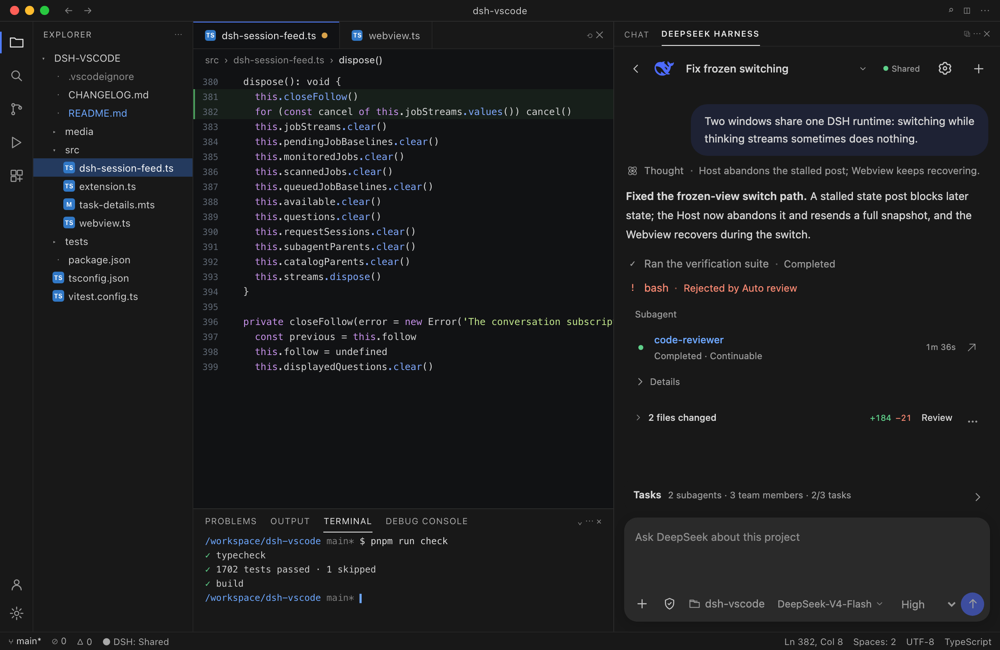

# DeepSeek Harness for VS Code 🐋

> [!NOTE]
> **This is a personal fork of [Lixxx1/dsh-vscode](https://github.com/Lixxx1/dsh-vscode)** (MIT License),
> maintained independently and pinned to a newer DeepSeek Harness release than the upstream build.
> Original work © Lixxx1. Not affiliated with DeepSeek or with the upstream project.
>
> Fork: https://github.com/fallleaves01/dsh-vscode

DSH Sidebar integrates the official DeepSeek Harness runtime with VS Code. It provides project-aware conversations, independent subagent details, explicit file references, and native change review.

*This fork is maintained with DeepSeek Flash as the coding agent.*

The current source version is **0.2.2-rc.2.1**. See [CHANGELOG.md](CHANGELOG.md) for version changes. The original extension was created by [Lixxx1](https://github.com/Lixxx1).

> [!IMPORTANT]
> **Automated maintenance.** All current maintenance of this fork is performed through automated updates generated by the **deepseek-flash** model. Code changes, DSH adaptation work, tests, documentation, and release preparation are produced by that automated workflow. This repository is therefore maintained as an automatically updated project rather than by a human release team. Review each release before production use.

**English** | [简体中文](README.zh.md)

[GitHub](https://github.com/fallleaves01/dsh-vscode)

[](https://github.com/fallleaves01/dsh-vscode/actions/workflows/ci.yml)
[](LICENSE)


<p align="center">
  
</p>

## ✨ Features

- **Conversations and history.** Stream responses, inspect tool calls, answer approvals and questions, and load earlier messages through the official DSH runtime.
- **Failed response recovery and retries.** Keep received output when a request fails, show its error code and a readable reason in chat and subagent details, and restore saved failed attempts when reopening history. Retried attempts collapse into one expandable row ("Retrying model request (1/3) · 1s", "Retried model request", "Model request retry cancelled") with retry delay and failure reason; a turn stopped by the output token limit shows DSH's cut-off notice. Retries remain separate; output that could not be saved is marked as available only in the current view.
- **Conversation directory.** Use the directory for recent and archived conversation lists, search, rename, archive with Undo, and restore. The local filter matches a case-insensitive substring of either the conversation title or the session ID, and message bodies are searched when history search is enabled. A row whose runtime reports a working directory shows it in the row tooltip and accessible name, so conversations with the same title or no project group can be told apart; a row without one keeps its previous tooltip. New conversation opens the full chat composer with model, reasoning effort, agent composition, and permission controls. The top picker switches main conversations; subagents remain in the owning conversation's Tasks panel.
- **Conversation actions.** Pin or unpin, rename, fork, archive or restore, and copy the session ID from the conversation menu. While the conversation that is open in this window is not archived, the same menu copies its complete history as Markdown. On DeepSeek Harness `0.2.2-rc.2`, archiving can also remove a clean Git worktree created by the runtime (branches and commits are preserved); see the rc.2 upgrade notes before archiving. Branching a completed turn forks at that turn's own boundary, so later stopped or failed work is not copied.
- **Independent subagent details.** Click a subagent name in its tool card to enter the child conversation, or use the trailing arrow to open independent details. Inspect live state, its transcript, tool output, duration, and token usage. Answer approvals and questions, stop a task, or send Queue/Steer messages when the parent agent permits continuation. One-shot children have a read-only composer. External executions appear as informational rows without a local transcript. With DeepSeek Harness `0.2.2-rc.2`, stopping a subagent uses the new user-interrupt call and falls back to the earlier parent-interrupt call only when the runtime does not serve it; a named subagent resolves its card link through the open conversation's subagent catalog.
- **Background tasks and task services.** Inspect bounded process output, Goal status and round limits, Schedule reminders and delivery history, and Workflow phases and job logs when the runtime exposes these services. Search conversation message bodies when history search is enabled.
- **Explicit file context.** Use `+` to search and add workspace files or folders, remove each reference with `×`, or use typed `@` references and **Add Selection to Chat**. The current editor and selected lines are optional suggestions. Select resources in the Explorer and run **DeepSeek Harness: Add to Chat** from the context menu; use **Upload from this computer…** for local files; or drop operating-system files onto the composer (hold Shift if VS Code suppresses the drop). See [Adding files to the composer](#adding-files-to-the-composer).
- **Quoted message text.** Select text in a user message or a completed reply, then choose **Quote text** to add it to the composer as a link-like quote chip. Sending emits the same Markdown blockquote DSH Web uses; quotes can be removed with `×` and cannot be combined with slash commands. See [Quoting message text](#quoting-message-text).
- **Conversation controls and queues.** Select agent composition, Permission and Plan modes, Model, and Reasoning Effort. Queue follow-up messages, steer an active task, and inspect or remove held slash commands.
- **Compact change review.** Expand the file-count and line-count summary, or open Review in VS Code's Diff Editor. Keep/Revert actions retain per-turn snapshots and are bound to their originating conversation and project; confirmation rechecks the target before a revert.
- **Answer file links.** Open a file named in an answer from the start line the link carries. Hash fragments `#L5` and `#L5-L9` and colon suffixes `path:5`, `path:5:3` and `path:5-9` are accepted; the range end and column are validated only, so the file opens at the start line without selecting a range or applying a column. An invalid fragment or line (`#L5:3`, `#L0`, `#L2-L1`, `#5`) opens the file without a selection instead of dropping the link. A destination that contains a Unicode control or format character, literal or percent-encoded, is refused.
- **DeepSeek authentication.** Configure an API key or use browser account sign-in, inspect account state and balance, and sign out. Remote sign-in uses VS Code port forwarding.
- **Runtime plugins and configuration.** Discover and manage Tools, Skills, MCP integrations, Memory, and Agent Hooks. Open the settings gear for Models, Shell, Agent loop, Subagents, Web search and General settings. Add providers, edit model catalogs and manage write-only credentials through DSH. When the runtime reports a registry update source for an installed third-party profile bundle (`update: 'registry'` on `0.2.2-rc.2`, `updatable` on `0.2.2-rc.1`), the Plugins settings page lists its published versions and updates it after a confirmation; a Git-installed bundle is shown read-only there and is updated through the DSH plugin manager. The Experimental bundles and Third-party bundles cards offer **Details…**, which reads the bundle's localized long description and opens it in a read-only Markdown preview under an opaque virtual document, so no local or package-internal path is exposed; relative images in these documents are not rendered.
- **Runtime recovery.** Reuse a managed runtime across VS Code windows, reconnect, diagnose conversation ownership, and end a verified leftover managed runtime. Saved external runtimes are attach-only.
- **Runtime manager.** Run **DeepSeek Harness: Manage Runtimes**, or click the **External**/**DSH**/**Shared** status control, to list the current connection, saved external runtimes, and runtimes this extension started. Start a managed runtime, connect by launch URL, restart, reconnect, disconnect, end a verified extension-started runtime, forget a saved runtime, or open occupancy diagnostics. A runtime you started yourself and never connected or saved is not visible here.
- **Native debugging and keyboard access.** Enable autonomous debugging for `.vscode/launch.json`, including breakpoints, stepping, stack frames, and variables. `Cmd/Ctrl+Alt+D` opens chat, `Cmd/Ctrl+Alt+E` opens it in an editor tab, `Cmd/Ctrl+Alt+L` adds the selection, and `Cmd/Ctrl+Alt+F` requests a file fix. Chat and task details support dark, light, and high-contrast themes.

## 🧭 Reliability and diagnostics

State delivery from the runtime to the sidebar is bounded. At most one view
state is in flight; newer states collapse into the newest one, and a delivery
that has not settled after 2 s is abandoned, followed by a full snapshot. If no
newer state follows, the Host retries one full snapshot 1.5 s later, throttled
to one retry per 10 s. The Webview also asks for a snapshot after 5 s without
state in a live phase — opening, running, stopping or cancel requested — and a
startup probe covers the case where the first state itself stalls. The two
paths cover each other, so either side's stalled channel can recover the view.
Three consecutive stalled deliveries show a reload-window warning, because a
channel that keeps stalling cannot be recovered from inside the view; run
**Developer: Reload Window** if the view stays frozen after that warning.

Selecting a conversation acknowledges the click immediately with a
"Switching to …" header while the snapshot is pending, and shows a retry hint
after 10 s. A rendering failure is reported to Output and triggers a
resynchronization instead of leaving a partially rendered view.

These diagnostics are written to the local **DeepSeek Harness** Output channel
(**Show Output**): one line per conversation selection with phase and running
state, opening/opened timings, slow deliveries, stalls and resynchronization
requests. They contain conversation identifiers, phases and timings; failure
lines also include the runtime's error text. Credentials are redacted by the
existing DSH error wrapper, but review the panel before sharing it. The
extension itself has no telemetry. See [Privacy and verification](#privacy-and-verification).

Startup and switching are also bounded. The CLI version is cached per
executable, the event-stream baselines and the first conversation list start
together, and a re-resolved view or Open in Editor reuses the active
connection. Switching reuses runtime-wide account, translation and schedule
facts and per-conversation ratings instead of re-reading them; a hidden
conversation directory is not rendered, and an unrelated state patch does not
repaint the transcript.

## 📦 Install

Install the official DeepSeek Harness CLI:

```sh
npm install -g @deepseek-ai/dsh
```

Install DSH on the host where the extension runs. For Remote SSH, this is the remote host. DeepSeek Harness `0.1.2-rc.1` or newer is required. History search and Schedule need `0.2.0-rc.2` or newer; the conversation event-stream client is verified against `0.2.2-alpha.2`, `0.2.2-alpha.3` and `0.2.2-rc.1`, while the experimental bundles are verified against `0.2.2-alpha.2`; `0.2.1-rc.2` and `0.2.1-rc.3` remain supported. This build also supports `0.2.2-rc.2`: its adapted plugin-manager, Agent Teams, web-search and subagent calls are covered by unit tests and an isolated runtime probe, not by a model-turn end-to-end run. Schedule supports the `0.2.2-alpha.2`, `0.2.2-alpha.3` and `0.2.2-rc.1` catalogs and history. The alpha CLI itself requires Node.js 24.9 or newer. npm `latest` still resolves to `0.2.2-rc.1`; `next` names `0.2.2-rc.2`, so a default install keeps rc.1 and rc.2 is installed with `npm install -g @deepseek-ai/dsh@next` or the exact `0.2.2-rc.2` version.

### Published release

Download the desired `.vsix` asset from [GitHub Releases](https://github.com/fallleaves01/dsh-vscode/releases). In VS Code, run **Extensions: Install from VSIX...** and select that file. The extension ID for this fork is `fallleaves01.dsh-sidebar`.

Published assets can lag behind `main`. Build the source below if the required version is not yet attached to a release. The Marketplace listing linked by the upstream project uses its own publisher and release schedule.

### Latest development build

Build the current source using the pnpm version specified in `package.json`:

```sh
git clone https://github.com/fallleaves01/dsh-vscode.git
cd dsh-vscode
pnpm install --frozen-lockfile
pnpm run package
```

Run **Extensions: Install from VSIX...** and select the generated `dsh-vscode.vsix`. To update a source build, pull the changes and rebuild. Check the installed version in the Extensions view.

Requires VS Code 1.100 or newer and Node.js `^22.19.0` or `>=24.0.0`.

Installing community runtime plugins also requires `pnpm` on your PATH.

For a full local check run `pnpm run check`; `./build.sh` writes
`artifacts/dsh-sidebar-<version>.vsix`. Other settings include
`reuseExistingRuntime`, `rememberExternalRuntime`, `executable`, `arguments`,
`startupTimeout` and `searchBaseUrl`.

### Upgrading to 0.2.2-rc.2.1

0.2.2-rc.2.1 is the first build that supports DeepSeek Harness `0.2.2-rc.2` while keeping `0.2.2-rc.1`. rc.2 is published on the npm `next` channel only: `latest` still names rc.1, so a default install is unchanged, and rc.2 is installed explicitly with `npm install -g @deepseek-ai/dsh@next` or `@deepseek-ai/dsh@0.2.2-rc.2`. Both runtimes use the same extension build, and every changed contract is read in both shapes. The official rc.2 upgrade guide has 19 entries; two are protocol-level for this sidebar, the archive-worktree behaviour is user-visible, and the removed subagent-interrupt call (which the guide does not list) is handled as well.

**Third-party bundles.** DSH `0.2.2-rc.2` replaced `BundleInfo.updatable` with `BundleInfo.update: 'registry' | 'git'`. An installed bundle with a registry source keeps **Check for updates**, the published-version list and the confirmed update; a Git-installed bundle appears in the same section with a read-only note and is updated through the DSH plugin manager, because this page cannot list or install Git versions. An `0.2.2-rc.1` `updatable` row is treated as a registry source. A plugin-manager `unexpected-package` failure now has its own explanation instead of a generic one.

**Web search billing.** On rc.2, the Search / Fetch API settings card exposes `searchBilling` and `fetchBilling` (Automatic, Signed-in DeepSeek account, DeepSeek API key) and hides the retired singular endpoint field; the API-key hint now says that a signed-in account can be used when the billing setting allows it. The rc.2 default search provider is `deepseek-search-api`; the existing provider switch keeps working.

**Agent Teams and named subagents.** The rc.2 `agentTeam` projection carries an `enabled` selection and the task board instead of a roster. The Tasks panel shows **Team on**/**Team off** with an **Enable team**/**Disable team** button backed by `agentTeams/setEnabled`; when the team is on, teammate rows come from the `subagentCatalog` projection of named subagents, and a tool card that names an agent resolves its link through that catalog. An `0.2.2-rc.1` runtime answers the selection call as unsupported and keeps its roster panel. An off team with an empty board stays hidden on rc.2.

**Subagent stop.** rc.2 removed `subagents/interruptByParent` in favor of `subagents/interruptByUser` (child id only). The sidebar calls the new method first and falls back to the old shape only when the runtime reports that the new method is missing; transport failures never trigger the fallback.

**Archive worktrees.** On rc.2, archiving a conversation can also remove a clean Git worktree created by the runtime; branches and commits are preserved. The sidebar does not manage worktrees and has no confirmation step, so before archiving, decide whether the directory must be kept, and enable the worktree service's `retainOnArchive` setting if it must be. This is a runtime behaviour change, not a sidebar prompt.

**Error messages.** New attachment and image admission codes on failed turns and tool results, and the plugin manager's `unexpected-package`, now show actionable sentences; unknown codes keep the existing neutral fallback. The Gemini native protocol appears as "Gemini API" in the custom provider picker.

DeepSeek Harness `0.2.2-rc.2` is the latest release on the `next` channel; `latest` still names `0.2.2-rc.1`, so no default install changes. The adapted calls were exercised against a real isolated rc.2 runtime (`settings/describe`, `pluginManager/listBundles`, `agentTeams/setEnabled` and the `agentTeam` projection, plus the presence of `subagents/interruptByUser`); no model conversation turn was run, and no manual smoke test was performed in a real VS Code extension host. Reload the VS Code window after updating.

### Upgrading to 0.2.2-rc.1.6

0.2.2-rc.1.6 adds plugin long-description viewing for the `0.2.2-rc.1` runtime baseline. The Experimental bundles and Third-party bundles cards in Settings → Plugins gain **Details…**, which reads the bundle's localized long description through `pluginManager/readBundleDetail`: the manifest's locale detail file when the runtime has one, otherwise the package README. The request uses the VS Code display language, normalized to the runtime's BCP 47 grammar with `en` as the fallback when the language is empty or unrecognized. Installed bundles are read from the runtime's directory without network access; an official bundle this installation does not ship is read from the npm file CDN with a network request. A document above the runtime's default 1 MiB limit is refused. The Markdown opens in the VS Code Markdown preview as a read-only virtual document identified by an opaque token URI, with the same document in a plain text editor as the fallback when the preview command fails; nothing is written to disk, the Output channel or Webview state, and errors use fixed classified copy instead of the runtime diagnostic or a package-internal path. Because viewing a detail is a read, read-only profiles and attach-only external runtimes can use it too. The VS Code Markdown preview applies its own resource policy: a third-party detail document can reference remote images that the preview then requests, which reveals the reader's address and timing to that host. The sidebar never fetches or rewrites those resources.

Known degradation: relative images in a detail document are served by the runtime's authenticated `/api/plugin-manager/detail-file` route, which the VS Code Markdown preview cannot authenticate or resolve. Those images therefore do not render, and the preview is not identical to the DSH Web detail page. This is deliberate: the document reaches the preview unchanged rather than being fetched, rewritten to data URIs, or persisted.

This release also hardens two existing surfaces. Chat file-link path validation now rejects every Unicode control and format character (C0, C1 and `Cf`, including bidirectional overrides and zero-width characters) after percent-decoding, so neither a literal nor an escaped character can hide or reorder the destination; legitimate non-ASCII names and the Windows drive rule are unchanged. A failed session Markdown copy keeps its notice visible until the next user interaction, a replacing notice, or a 15-second safety bound instead of four seconds, and exposes the failure as an alert for assistive technology. The restart-reason whitelist and copy used by third-party bundle updates now come from one shared definition; the wording and behaviour are unchanged.

DeepSeek Harness `0.2.2-rc.1` remains the latest candidate release with no version drift, so no runtime upgrade is required. The new behaviour is covered by unit tests; no end-to-end run against a live DSH runtime and no manual smoke test in a real VS Code extension host were performed for this build. Reload the VS Code window after updating.

### Upgrading to 0.2.2-rc.1.5

0.2.2-rc.1.5 is a maintenance release for the `0.2.2-rc.1` runtime baseline. Conversation rows now show the working directory that the runtime reports in the row tooltip and accessible name, which distinguishes conversations with the same title or no project group; a row without a reported directory keeps exactly its previous tooltip, and the directory is display-only. Answer file links adopt the DSH `0.2.2-rc.1` fragment syntax while keeping the sidebar's existing path rules: hash fragments `#L5` and `#L5-L9`, and colon suffixes `path:5`, `path:5:3` and `path:5-9`, are accepted. The range end and the column are validated only, so the file opens at the start line without selecting a range or applying a column; an invalid fragment or line (for example `#L5:3`, `#L0`, `#L2-L1` or `#5`) opens the file without a selection instead of dropping the link. Path, URL, shared-path and control-character checks are unchanged.

A session-Markdown copy that answers 404 now reports that the runtime may not support the export or that the conversation may no longer exist, instead of asserting that the runtime lacks the feature. The failure notice keeps an error style and stays visible for about four seconds rather than disappearing at the pace of a 1.6-second confirmation.

Third-party bundle updates now name the reason a restart is required, mapping the runtime's closed restart reasons to readable copy and falling back to the generic restart sentence for an unknown value. An update whose installed version could not be resolved keeps a neutral "installed bundle is unchanged" message. The client rejects an update result with an empty target version, and runtime display text strips C1 controls and Unicode format characters, including bidirectional overrides, in addition to C0 controls and DEL. A successful version check clears the previous update result, and version rows align with a monospaced version number.

The npm `latest` dist-tag now resolves to `0.2.2-rc.1` (it previously named `0.2.1-rc.5`); `next` and `alpha` are unchanged and no new version was published. This is a channel promotion, not a runtime upgrade: the support matrix already covers `0.2.2-rc.1`, so no protocol change is required. The new behaviour is covered by unit tests; no end-to-end run against a live DSH runtime and no manual smoke test in a real VS Code extension host were performed for this build. Reload the VS Code window after updating.

### Upgrading to 0.2.2-rc.1.4

0.2.2-rc.1.4 adds three DeepSeek Harness `0.2.2-rc.1` capabilities. The conversation actions menu gains **Copy Session as Markdown**: while the conversation that is open in this window is not archived, the action asks the runtime for its complete export and writes the returned Markdown to the clipboard. The runtime formats the document and includes its original log path, so the text covers the whole history rather than the loaded transcript window and matches the runtime's own export. The export route (`GET /api/session.markdown`) belongs to the DSH Web profile's HTTP surface, not to the RPC contract: a runtime that does not serve it (an older runtime, or a profile without the export bundle) answers 404 and the sidebar reports that this runtime does not support session Markdown export; an expired authentication reports that the runtime must be reconnected. A response above 32 MiB is refused, and the action is disabled for conversations that are not open in this window. The Markdown goes only to the clipboard: it does not enter the Webview state, the Output channel or a file, and a failure shows fixed classified copy instead of the response body, a local path or an exception message.

Settings → Plugins gains **Third-party bundles** for an installed profile bundle the runtime marks `updatable`. **Check for updates** lists the published versions with their publication date, prerelease, deprecation and incompatibility markers; registry URLs, attempt reasons, runtime diagnostics and package-manager output are never displayed. Choosing a version opens a modal confirmation that names the shared web profile, the other windows that use it, the hot-module-replacement stop, the attempted reinstallation of the previous version and the network requirement. The result is reported as one of five outcomes: updated, restart required, update failed with the previous version reinstalled, update failed with the previous version not restored, which is an explicit warning, or unchanged, which means the update was not accepted and the installed version is still in place. An unchanged outcome covers a refused target check, a failed or cancelled removal of the old version, and a non-HMR installation failure that leaves the old version installed; the sidebar reports that the previous version could not be restored only after a recovery reinstallation actually failed. A listed version that declares no plugin bundle is shown disabled with an explanation. The controls are disabled for attach-only external runtimes and read-only profiles, and only a version from the most recent listing can be installed, so a stale or forged version is refused before any profile write.

Conversation search now matches the typed query as a case-insensitive substring of either the title or the session ID, and message history continues to be searched when history search is enabled. README and adaptation documentation were corrected in the same change: bundle version lists and updates, Schedule task deletion and clearing ended tasks, and quoted-text insertion were previously described as unimplemented even though the first two are implemented and the third has been available since 0.2.2-alpha.2.7; plugin detail documents and market entry details remain unimplemented.

DeepSeek Harness `0.2.2-rc.1` is still the latest candidate release, verified on npm and GitHub with no newer version, so no runtime upgrade is required for this build. The new export route and the two plugin-manager methods are covered by unit tests with an HTTP mock; no end-to-end run against a live DSH runtime was performed for this build. Reload the VS Code window after updating.

### Upgrading to 0.2.2-rc.1.3

0.2.2-rc.1.3 turns the runtime manager into a multi-connection list. **Add runtime connection…** stores an external launch URL under a display name; the launch URL is kept in VS Code Secret Storage and never appears in the list, logs or state. The list shows every saved connection with its host and whether this window is connected, and each row can connect or delete the saved entry. Deleting a connection detaches this window only; the external process is never stopped. **Connect to runtime URL…** remains available for a one-off URL.

**Start new managed runtime** now starts a real managed process. DSH normally reuses a recorded attach-only external runtime; when such a record exists, the command warns that it will clear that saved record, starts the managed runtime, and leaves the external process running. Choose **Save and Start** to keep a reconnect entry first. If a managed runtime is already connected, the command offers Restart instead of pretending to create a second one. The Command Palette command and the Webview button use the same flow, so neither can silently adopt the saved external runtime again.

The manager still has one active connection per window and one managed runtime per DSH home. Saved external connections are entries to switch between, not concurrent chat connections. A managed runtime started this way may use a different DSH session store from the external process; connect back to the saved external connection when you need that runtime's conversations.

### Upgrading to 0.2.2-rc.1.2

0.2.2-rc.1.2 completes a compatibility and accessibility pass. History paging now prefers the current `session/events` endpoint and keeps a one-time fallback to `session/page` for older runtimes that do not serve `session/events`, so the deprecated endpoint is no longer the primary path. `apply_patch` now contributes its file headers and move/delete targets to the unsaved-file conflict check even when the runtime provides no presenter view. Every icon button and icon menu trigger in the chat and settings surfaces now has an explicit hover title and accessible name, with dynamic labels for runtime state, jobs, usage, account, task, send/stop and settings controls. Plugin discovery and official-bundle installation are available from the Command Palette. Reminders hide the current-conversation target inside a delegated subagent, delivery-history misses use readable copy, and a shared managed runtime that another window is using is reported as still running after this window disconnects. No DSH wire change is required for this release.

### Upgrading to 0.2.2-rc.1.1

0.2.2-rc.1.1 aligns the extension with DeepSeek Harness `0.2.2-rc.1`. That release has the same wire surface as `0.2.2-alpha.3` (its repository diff is limited to package versions and vendor version labels), so no protocol migration is required. This build adds **DeepSeek Harness: Manage Runtimes**, a native list of the current managed, shared, attached or external connection, saved external runtimes, and runtime records started by this extension. It can start a managed runtime, connect with a launch URL, restart, reconnect, disconnect the current connection, end a verified extension-started runtime, forget a saved runtime, or open session-occupancy diagnostics. The **External**/**DSH**/**Shared** status control now opens this list and explains its state on hover; the view-title restart action now says that it stops and starts DSH. Runtime listing is intentionally limited to runtimes this extension started or saved: a `dsh web` you started yourself and never connected or saved is invisible here. DSH `0.2.2-rc.1` requires Node.js 24.9 or newer; a runtime below that threshold keeps working in practice but is outside its supported range.

### Upgrading to 0.2.2-alpha.3.3

0.2.2-alpha.3.3 adds reminder creation and editing. The Goal & reminders panel now shows **New reminder** and **Edit**: creation asks for a title, the instruction, one of the seven alpha.3 timing forms (`after`, `at`, `every`, `daily`, `weekly`, `cron`, `rrule`) and a destination (this conversation, one new conversation, or a new conversation per delivery); editing changes the title, instruction or timing with the stored revision, so a concurrent change is reported as a conflict instead of overwriting it. The same release adds session-level feedback from the conversation actions menu (seven categories plus optional free text; it records immediately and starts no model turn) and a minimal plugin discovery surface: the Plugins settings page can search a configured plugin-market index, install a compatible version after confirmation, and install an official on-demand bundle such as a Claude Code/Codex subagent or Computer Use. Plugin-market index URLs are configured in DSH settings; this VS Code surface does not edit the index list. Reload the VS Code window after updating.

### Upgrading to 0.2.2-alpha.3.2

0.2.2-alpha.3.2 completes DeepSeek Harness `0.2.2-alpha.3` adaptation. Schedule/reminders now read alpha.3 host-wide tasks (destination, `active`/`paused`/`ended`, delivery receipts) and offer **Run now**, **Pause**/**Resume**, **Delete** and **Delete ended** with paged delivery history; alpha.2 catalogs and history requests remain supported. Archiving a conversation whose only activity is an active reminder retries with `stopActivity` and reports that reminders were stopped, while a running turn is never stopped implicitly. The alpha.3 `apply_patch` tool renders per-file diff cards and feeds Review Changes, changed-file lists, Revert and unsaved-file conflict checks. Slash commands that declare attachment input can carry staged file receipts alongside images; a runtime with the legacy images-only command protocol rejects files explicitly instead of dropping them.

### Upgrading to 0.2.2-alpha.3.1

0.2.2-alpha.3.1 adds DeepSeek Harness `0.2.2-alpha.3` compatibility. Alpha.3 batches `session/control` projection updates into `{ seq, changes: [{ key, val }] }` instead of one `{ key, value, seq }` frame per change; the previous parser rejected the new frame with `Invalid control update.`, and because `session/control` is a shared non-optional carrier, that rejection aborted all event streams with **DSH sent an invalid event stream frame. Reconnect to refresh its snapshot.** The parser now accepts both alpha.2 and alpha.3 shapes, validates a batch before applying it, applies each key with the existing snapshot floor, per-key sequence, prototype, inbox and subagent-catalogue rules, and diagnoses then ignores an unrecognized projection shape instead of aborting the carrier. DSH `0.2.2-alpha.2` remains supported. Reload the VS Code window after updating.

### Upgrading to 0.2.2-alpha.2.8

0.2.2-alpha.2.8 fixes reopening a very large conversation. The sidebar previously asked `session/follow` for a 100-message snapshot; when that snapshot exceeded the 8 MiB frame limit, the oversized frame was dropped without a protocol error and the conversation failed after an eight-second timeout, which repeated failures could turn into a runtime restart. The first snapshot now uses 30 messages and falls back to 12, 4 and 1 when a frame is still too large; an exhausted fallback reports an explicit oversized-snapshot error instead of a timeout. Older-history pages use the same page budgets, and frame sizes are measured in UTF-8 bytes. A normal conversation therefore starts with a shorter first page and loads older messages through the existing history control.

### Upgrading to 0.2.2-alpha.2.7

0.2.2-alpha.2.7 adds quoted message text. Select text in one user message or one completed assistant reply, then choose the floating **Quote text** action; the excerpt becomes a link-like chip above the composer. Sending serializes each quote as the same Markdown blockquote DSH Web uses, and the transcript renders it back as a quote preview. The selected text stays within one message body, quotes can be removed with `×`, a quote-only message is allowed, and a slash command cannot be combined with quotes. Each quote is limited to 100,000 characters; credential masks remain in the chip, tooltip and transcript. This is a composer adaptation: quotes are kept before the typed prompt rather than inserted at the caret inside a rich editor.

### Upgrading to 0.2.2-alpha.2.6

0.2.2-alpha.2.6 keeps the custom answer you type into a **DeepSeek needs your input** question card. The Webview requests a full state snapshot after about eight seconds without an update; the snapshot carries a new object for the same question, and the previous identity comparison rebuilt the card and discarded the text. Tail cards now rebuild only when their content changes; if a legitimate change does rebuild the question, its draft text, selected options, focus and caret are restored. Submitting after such a refresh sends the restored answer.

### Upgrading to 0.2.2-alpha.2.5

0.2.2-alpha.2.5 fixes **DeepSeek Harness: Add to Chat** in Remote SSH windows. VS Code can deliver an Explorer resource to the command as a `file:` URI whose path is still on the remote host; the command now restores the remote scheme from the workspace folder (or accepts an in-workspace remote path directly) and resolves the reference normally. A genuinely client-local path is rejected with instructions to use the remote Explorer or **+ → Upload from this computer…**. The DeepSeek Harness output channel records one diagnostic line when this recovery runs.

### Upgrading to 0.2.2-alpha.2.4

0.2.2-alpha.2.4 fixes operating-system file drops into the sidebar. VS Code's Webview preload forwards an unguarded `dragover` to the workbench, which sets the iframe to `pointer-events: none` after the first movement; the composer now handles the drag in the capture phase and keeps the iframe hit-testable. The **+** menu also gains **Upload from this computer…** for the local file dialog (including the local desktop of a Remote SSH window) and a Shift hint for platform-suppressed drags. Webview runtime errors are now written to the **DeepSeek Harness** output channel. Install this build on the Remote SSH host as well, then reload the window.

### Upgrading to 0.2.2-alpha.2.3

0.2.2-alpha.2.3 adds the **DeepSeek Harness: Add to Chat** Explorer context command for files and folders; VS Code reserves in-workbench drag operations for view docking, so Explorer and editor-tab drags cannot reach a sidebar webview. Operating-system file drops remain supported and recover cleanly after cancelled or repeated drags. Install this build on the Remote SSH host as well, then reload the window.

### Upgrading to 0.2.2-alpha.2.2

0.2.2-alpha.2.2 fixes activation in VS Code 1.144 Remote SSH windows: the remote extension host exposes `navigator` as a throwing getter, and zod read it while the MCP SDK built schemas during module load, aborting activation before the sidebar or drag and drop could start. Install this build on the Remote SSH host (not only on the local window) and reload the window afterwards.

### Upgrading to 0.2.2-alpha.2.1

0.2.2-alpha.2.1 adds composer drag and drop: Explorer and editor-tab drops insert DSH `@` references, while operating-system files upload through the runtime attachment library with upload state, **Retry** and removal controls. It also hardens reference resolution and upload cleanup (six audit findings) and bounds a stalled reference resolution so later drops are never blocked. It still tracks DeepSeek Harness `0.2.2-alpha.2`; reload the VS Code window after updating.

### Upgrading to 0.2.2-alpha.2

0.2.2-alpha.2 tracks DeepSeek Harness `0.2.2-alpha.2`, adds its compatibility
and reduces startup and conversation-switch latency. 0.2.1 added DSH's conversation actions and
fixed the fork boundary; 0.2.0 was the client-side reliability release for Stop
and conversation switching. Reload the VS Code window after updating; a shared
managed runtime does not need to be restarted. It requires no DSH upgrade: the
sidebar probes capabilities at runtime, so `0.2.1-rc.2`, `0.2.1-rc.3` and
`0.2.2-alpha.2` runtimes all work, and experimental bundles appear only when the
runtime serves their contracts.

## 🚀 Use

1. Open a trusted project folder in VS Code.
2. Select **DeepSeek** in the right sidebar. If it is hidden, find it under **Other Views**.
3. Configure `DEEPSEEK_API_KEY` with the key button, or run **DeepSeek Harness: Sign In to DeepSeek Account**.
4. Select New conversation to open the full chat composer. Select Model and Reasoning Effort, add explicit file references, and send a prompt. The conversation-settings menu controls Permission and agent composition; `/plan` enters Plan mode, and `/` opens official DSH commands.
5. Use Tasks to open subagent details, and the change summary to review edits. Return to the directory to search, rename, archive, or restore conversations.
6. Use the settings gear or **DeepSeek Harness: Open Settings** for runtime configuration. The plugins button manages runtime plugins and also links to the settings page.

### Optional task services

Run **DeepSeek Harness: Configure Task Services** to access the extension's `enableHistorySearch` and `enableSchedule` settings. They enable message-body search and Schedule in a standard managed DSH Web runtime. Restart that runtime to apply the change. Custom and external runtimes must expose the corresponding services in their own profile.

### Background tasks

The toolbar **Background jobs** menu follows the DSH Web jobs surface for the runtime's `session/jobs` rows. Switch between **Project** (jobs known across the project's conversations) and **This chat**. Running jobs appear first; **Finished** jobs are grouped, count-labelled, collapsible, and can be hidden locally with **Clear** (no runtime mutation). A row shows live `progress` when the runtime publishes it, otherwise the status detail and elapsed duration. Only a live job or a settled job with retained output has an output chevron.

Expanding a row observes that job with `job/follow` while the panel is open and releases the observation when the row is collapsed, the menu closes, the scope changes, or the runtime disconnects. The inline panel is a bounded output tail: it shows stdout/stderr/log channels, reports dropped or interrupted output, and offers **Copy command** (the command line, not the possibly truncated output). A job from another known project conversation can be observed from the **Project** aggregate; an unknown job or a disconnected runtime reports that the task is no longer available.

**Stop** uses the two-press DSH interaction. The first press arms the row for three seconds; the second press enters a disabled **Stopping…** state until the `job/list` roster converges. A rejected stop shows **Stop failed** with the runtime's reason inline for four seconds, and a row that is no longer running clears the phase. Escape closes the menu and returns focus to the jobs trigger. Kill requests are deduplicated while in flight.

### Adding files to the composer

VS Code reserves drag operations that start inside the workbench (the Explorer or an editor tab) for view docking: the workbench handles them before they reach a sidebar WebviewView, so a composer drop cannot receive them. Add those resources explicitly instead:

- Select one or more files or folders in the Explorer, open the context menu, and choose **DeepSeek Harness: Add to Chat**. The selection becomes DSH references in the prompt: paths inside the project are relative, paths outside stay absolute, a folder ends with `/`, and a path containing whitespace is written as `@"path with spaces"`. The reference is prompt text only: the sidebar does not copy, upload, or read the file contents. Use **Add Selection to Chat** for an editor selection; its line range is carried as separate IDE context. The composer's **+** menu offers **Add files…** for the same workspace paths.
- Use **Upload from this computer…** in the **+** menu to open the local file dialog. This is the most reliable way to add files that are not in the workspace, including files on the local desktop of a Remote SSH window: the Webview reads the selected bytes locally and the extension uploads them to the runtime.
- Dragging files from the operating system into the composer is supported. VS Code's Webview drag guard can disable the iframe after the first `dragover`, so if a drop does not react, hold **Shift** while dragging and drop again. A VS Code webview runs in a sandbox and cannot read the operating-system file path, so the sidebar follows the DSH browser behavior and uploads the bytes. Non-image files are written to the runtime attachment library on the machine running DSH, below `<DSH_HOME>/attachments/v1`; the runtime keeps them on disk and does not remove them automatically when the conversation is removed. Images are sent as inline message data.
- A drop or local-file selection accepts at most eight files (images included), and each file must be no larger than 32 MiB. Wait for uploads to finish before sending. An upload shows `Uploading…`, then a ready attachment or `Upload failed` with **Retry**; remove any attachment with `×`. An operating-system folder cannot be dropped or selected; add the folder through the Explorer context command instead, where it becomes an in-place reference.
- The composer's **+** menu also offers **Attach image…** for image-only selection.
- References expose the original path to the model; an upload copies the bytes and persists them in the runtime attachment library. DSH Desktop can use its native host-path bridge to turn an external drop into a reference; VS Code has no such bridge, so operating-system files are always uploaded here.

### Quoting message text

Select text within one user message or one completed assistant reply. A floating **Quote text** action appears above the selection; choosing it adds the excerpt to the composer as a link-like quote chip. The selection must stay within one message body: streaming, failed, deferred, tool and notice rows, selections that cross messages, and read-only child sessions do not offer the action.

- Quotes appear above the textarea in insertion order. Hover a chip for up to 2,000 characters of the masked excerpt; remove it with `×`. The chip truncates long excerpts but keeps the whole selected text for the send.
- On send, each quote becomes a Markdown blockquote with one `> ` prefix per line, in insertion order, followed by one blank line and the typed prompt. This is the model-visible form DSH Web uses; the transcript renders the same blockquote as the same link-like quote. Without a quote, the sent text is exactly the trimmed prompt as before.
- A quote-only message is allowed. If the typed prompt would route as a slash command or skill (`/compact`, `/plan`, `/permission …`), the send is refused while quotes are present, because the blockquote would change the first token the runtime routes; remove the quote to run the command.
- The sidebar keeps each quote as a chip before the typed text rather than as an inline node placed at the caret as DSH Web does; the model-visible Markdown is the same. A chip has no editor undo. Recognized credentials stay masked in the chip, its tooltip and the transcript quote. Masking is display-only: a quote whose selected text contains a recognized credential (for example a raw key in an assistant reply) shows a warning, and the model receives the selected text as written. When credential masking is unavailable, the chip shows only **Quoted text** rather than the raw value.
- A selection longer than 100,000 characters is refused.

### Shared runtime across windows

With `reuseAcrossWindows` enabled, windows on the same host and OS account share
one DSH process for the same `DSH_HOME` and compatible launch settings, including
history search and Schedule. VS Code profiles may differ. The first window can
close while the others continue; the last normal exit stops DSH. A small helper
process owns and drains DSH output. It does not modify the DSH installation or
its user configuration, write output logs, or automatically restart DSH.

The toolbar shows **Shared** when this window has connected to an existing managed
instance; hover to see its PID. **DSH** identifies an instance started by this
window, and **External** identifies an explicitly attached runtime. Click this
control to open the runtime manager; its hover text names the current ownership
and the available action. If no connection is established, **Connect** or
**Retry Connection** checks the saved runtime before starting a new one. Loading
shows the current connection, event-stream or history stage, with **Show Output**
available throughout. Logs include elapsed connection times without credentials.
Disabling `autoStart` leaves the view idle with a Connect action.

On **Linux Remote–SSH**, each window's lease and startup/shutdown operation are
bound to its verified VS Code Server process identity. An extension host left
behind by a dead server cannot keep DSH alive. Other windows with valid owners
continue to use the same instance. Server inspection reads at most eight direct
ancestors from `/proc`; it does not scan the server's files or process table.

An unexpected SSH disconnection leaves tasks running while the remote extension
host remains alive. Configure the native grace period in **local User Settings**:

```json
{
  "remote.SSH.reconnectionGraceTime": 43200
}
```

The value is in seconds; this example is 12 hours. The Remote–SSH setting currently
supports Linux remotes and requires restarting the remote VS Code Server to take
effect. The extension neither changes this setting nor restarts the server.
Normal window closure can terminate the extension host immediately; the setting
is a reconnection grace period, not a keep-running-after-close guarantee.
See [Remote–SSH release notes](https://github.com/microsoft/vscode-docs/blob/main/remote-release-notes/v1_107.md).

After all valid owners exit, the helper checks every five seconds and begins
cleanup after a 30-second grace period. It sends SIGTERM, then SIGKILL after four
seconds if needed, and bounds its wait for inherited output pipes. On POSIX it
also signals DSH's dedicated process group; tools that deliberately detach into
another group are outside this guarantee. A surviving attached window can detect
a killed helper and clean up its identified DSH process. Reopening after shutdown
loads saved history; it cannot resume an interrupted model request or tool call,
or recover events that had not reached the log before forced termination.

These are scheduling-dependent bounds, not real-time guarantees. Simultaneous
SIGKILL of the helper and every extension host leaves no running cleanup code.
On the next managed connection, the extension checks the private registry before
opening a conversation. A compatible runtime with a live helper is reused. If
the helper is confirmed dead and no valid window still uses DSH, a verified
remaining DSH process is stopped before a supervised replacement starts. Multiple
reconnecting windows serialize this recovery and share one replacement. New
helpers also persist DSH's process identity before publishing its connection URL,
so an interrupted startup can be recovered in the same way.

SIGSTOP, kernel-blocked I/O, denied signals, or unreadable identity/lease records
can prevent cleanup. A startup killed before its process identity was recorded
cannot be safely terminated automatically. Uncertain records are retained and a
competing runtime is not started. Use **Restart Runtime** or **End a Leftover
Runtime** for verified recovery; other live users require a reviewed shared
restart. External runtimes are never stopped by these mechanisms.

Launch settings must agree in both windows. Connection failures or incompatible
settings retain the existing instance and report an error. Use **Reconnect** for
one window. **Restart Runtime** can replace the recorded managed runtime with this
window's settings, including after an incompatible-settings failure. If other
windows use it, a confirmation explains that their running conversations, subagents
and scheduled work will be interrupted. Cancellation leaves running work intact.
The process and affected windows are checked again before shutdown; a replacement
starts only after the old process exits. Reload the other windows with matching
settings to connect to the replacement. External runtimes remain attach-only. Native
autonomous debugging requires a dedicated runtime because its bridge belongs to
one VS Code window. Disable autonomous debugging for shared mode.

When upgrading from before 0.1.15, finish active work, update all using windows,
and use **Restart Runtime** to replace the previous helper. Version 0.1.14 changed
the host protocol; 0.1.15 adds startup identity recording. Older helpers do not
gain these protections merely by reconnecting. The 0.1.16 connection UI update can
reuse a compatible 0.1.15 helper after reloading the updated windows.
The private registry is under `~/.dsh-vscode/runtimes/`, partitioned by host and
DSH home; migration retains a known legacy ledger so existing leases stay visible.

### DSH settings

The chat gear opens settings inside the conversation as a modal, with the official
DSH navigation icons, section layout, provider cards, and a narrow-sidebar icon rail.
The command **DeepSeek Harness: Open Settings** offers the same page in an editor tab.
The page follows the official DSH settings cards: account status and session-log
upload, provider endpoints and model catalogs, Shell timeout/output limits,
parallel tool calls, subagent limits and allowed model routes, and web search.
Search supports the official Messages API or the paired Search / Fetch APIs,
with separate endpoints, limits, and write-only credentials. On `0.2.2-rc.2` the
same card exposes the runtime's search and fetch billing selects (Automatic,
Signed-in DeepSeek account, DeepSeek API key) and hides the retired singular
endpoint field when the schema omits it. Custom Pi provider
models offer a reasoning-level/API-value table when the runtime schema supports it.
Appearance and keyboard shortcuts use VS Code's native settings.

Provider changes are staged until Save. Model lookup returns selectable
candidates without storing them. Per-field Reset restores inherited values;
conflicts retain drafts, and a changed runtime clears drafts before accepting
new writes. External attach-only runtimes remain available for inspection.

Provider keys entered on this page use DSH's credential service, whose default
local store is `$DSH_HOME/.credentials.yaml` with owner-only permissions on POSIX.
This is separate from the provider profile and from the extension's existing
SecretStorage key. It is not an encrypted vault or an isolation boundary against
tools running as the same OS user. Stored key values are never read back into the
page, and this repository and its VSIX exclude the credential file and backups.

### DSH 0.2.2-alpha.2 and alpha.3 experimental features

The conversation event-stream client is verified against the official DeepSeek Harness `0.2.2-alpha.2`, `0.2.2-alpha.3` and `0.2.2-rc.1` runtimes; `0.2.1-rc.2` and `0.2.1-rc.3` remain supported. The experimental bundles are still verified against `0.2.2-alpha.2`; Schedule is verified against `0.2.2-alpha.2`, `0.2.2-alpha.3` and `0.2.2-rc.1`. This build adds support for `0.2.2-rc.2`: its plugin-manager, Agent Teams, web-search and subagent-interrupt surfaces are read in both runtime shapes and verified by unit tests and an isolated rc.2 runtime probe. No model-turn end-to-end run was performed against rc.2. Experimental bundles remain opt-in in the runtime profile; the sidebar does not enable them automatically (the Plugins page can switch them when the runtime allows writes), and each feature appears only when the runtime exposes its contract. A runtime without the feature keeps the previous behavior. The alpha release adds Web-first optional bundles (Live Share, Forge, Computer Use and personalized recommendations); they appear in the Plugins list with their platform and installation state, but this sidebar does not implement their Web panels.

The following alpha.2 surfaces are Web-only and are not implemented in this
sidebar: Live Share, Forge, Computer Use and personalized-recommendation panels;
the Statistics tab; creation, file-drag and plugin-recommendation cards. Their
tools use the generic tool card. Action-card proposals (`propose_action`) also
render as generic tool cards without the card buttons. Market entry details
(`pluginMarket/readEntryDetail`) are not implemented; use the DSH Web plugin
manager. Bundle long descriptions are available through **Details…** in the
Plugins settings page, and version lists and updates of an updatable third-party
profile bundle are implemented there as well. An on-demand bundle that is not installed is not listed here; install it from the DSH plugin manager. Quoted
messages render as Markdown blockquotes; **Quote text** adds an excerpt to the
composer as a chip before the typed prompt rather than as an inline node at the
caret. Auto review approval reasons follow the editor
language; an Auto review *failure* (`AUTO_REVIEW_FAILED`) renders as an
ordinary tool failure. Web appearance settings (`ui-theme`, `ui-settings`,
`ui-conversation`, `ui-chat`, including `foldedReplies`, and `locale`) and the
Web default-model/default-permission settings do not apply to VS Code; model
badges are not shown, and PNG/JPEG references that predate the stored byte
length cannot be read on alpha.2. Computer Use also needs macOS and the runtime's
native CUA binary; when that binary is missing the bundle switch reports a
platform/operation failure instead of appearing enabled.

Related DSH Web management surfaces are also not implemented in this sidebar:
stopping and archiving a running conversation (`workspace/archiveSession` with
`stopActivity`); generic slash-command option risk confirmation; and the Task
Details command bar with links to the full retained output stream. Schedule task
deletion and clearing ended tasks are implemented in the Schedule panel. Live
Share stop-sharing confirmation and Forge merge confirmation remain Web-only
together with their panels. Background jobs themselves are implemented in the
**Background jobs** menu described above.

- **Auto review permission preset.** The Permission selector reads `permissionPresets/catalog`, so the experimental `auto` preset appears when the auto-review integration is mounted. It is marked `EXP` and switching to it, from the selector or by typing `/permission auto`, requires an explicit acknowledgement: it runs without a sandbox, asks the same model to review every tool call, can wrongly allow or deny actions, and uses additional tokens. A runtime that does not serve the catalogue keeps the shipped three presets.
 A tool call refused by Auto review renders as "Rejected by Auto review" in the collapsed row and "Tool was not executed. Reason: …" when expanded; a missing reason falls back to "Auto review did not authorize this action".
- **Agent Teams.** When the `agentTeam` Session projection is present, the Tasks panel shows the durable team roster with lifecycle phase and Lead/Teammate role, and the shared task board with status, readiness, blocked-by ids, owner, and write scopes. Member rows open the member conversation, and Team tool cards link to a member once its name resolves against the projection. The task board is read-only: task state is owned by the runtime and written through the Team tools. On `0.2.2-rc.2` the projection carries an `enabled` selection and the task board instead of a roster: the panel shows **Team on**/**Team off** with an **Enable team**/**Disable team** control backed by `agentTeams/setEnabled`, and teammate rows are derived from the `subagentCatalog` projection of named subagents; an off team with an empty board keeps the panel hidden, and an `0.2.2-rc.1` runtime reports the selection control as unsupported while keeping its roster view.
 Member rows show the lifecycle phase and, derived from the session list, Running, Inactive, Failed or Provisioning; the projection's `phase` alone only records that the member record exists.
- **Live conversation titles.** The conversation-following title provider updates the existing `title` projection and `session/title` event. The sidebar already refreshes the title bar and conversation list from that projection, so titles change without reloading the list.
- **Experimental settings and bundle management.** The Settings page lists the runtime's optional bundles under Plugins → Experimental bundles, with their enable state, version and description; when this extension owns the runtime, a switch enables or disables one through `pluginManager/setBundleEnabled`. A running task does not block the switch: the runtime owns that decision and answers with `applied` or `restart-required`, which the page reports instead of pretending the change already applies. The switch is refused for an attached external runtime and when the runtime does not allow settings writes; the page asks for confirmation before the change. When the runtime serves the corresponding settings namespaces, the same page renders Reasoning translation (`cot-translation`: provider, target language), Voice input (`speech-to-text`: provider, language) and Plugin market (`plugin-market`: index URLs); a bundle that is not mounted hides its card. With the translation bundle mounted, expanded reasoning is translated in place through `cotTranslation/limits` and `cotTranslation/translate`, showing the translation by default with a View original toggle and a Retry action when the selected service cannot answer. Expanded reasoning is sent to that service, so it may contain private code or conversation details. The same page lists an installed third-party profile bundle that the runtime reports as registry-updatable (`update: 'registry'` on `0.2.2-rc.2`; `updatable` on `0.2.2-rc.1`) under **Third-party bundles**: **Check for updates** shows the published versions with date, prerelease, deprecation and incompatibility markers, and a chosen version is installed only after a modal confirmation. Registry URLs, attempt reasons and package-manager diagnostics are not shown; the result reports updated, restart required, restored, unrestored or unchanged, and the controls are disabled for attach-only and read-only runtimes. A listed version that declares no plugin bundle is shown disabled with an explanation. A Git-installed bundle appears read-only in that section, because this page cannot list Git versions. Both bundle areas offer **Details…**: `pluginManager/readBundleDetail` returns the bundle's localized long description (its locale file or README), which opens in a read-only Markdown preview as a virtual document, and a read-only or attach-only runtime can still show it. Relative images in these documents are served by the runtime's authenticated detail-file route and do not render in the VS Code preview.

Current state of the remaining experimental bundles (full package matrix and evidence in [the alpha.2 adaptation record](docs/DSH-0.2.2-ALPHA2-ADAPTATION.md); the earlier [rc.3 record](docs/DSH-0.2.1-RC3-ADAPTATION.md) remains for comparison):

- **Session search** adds model tools such as `session_search`; they use the generic tool card, while sidebar message search continues to use the standard `session/search` RPC. Do not enable both this bundle and the `enableHistorySearch` task service without checking the runtime profile: the deployment can mount two `session-query-sqlite` rows.
- **Plugin market and voice input** expose their configuration cards as described above, but the rest of the feature UI is not implemented: no market discovery, search or install (`pluginMarket/*`), and no speech capture or transcription (`speech/*`, whose stream methods require the existing stream carrier). Reasoning translation is implemented (see above). These bundles remain opt-in and Web-first; an installed but disabled bundle changes nothing in the sidebar.
- **Persistent terminal, Ralph loops, and the badge skill** need no dedicated sidebar work: their tools and skills use the generic tool card or the existing `skills/list` view. The sidebar does not expose a persistent terminal panel. PTC nested `tool/ptc-dispatch` rows are not rendered separately; the parent tool card shows the result.
- **Git worktrees:** `create_worktree` runs as a generic tool, but the effective `workingDirectory` Session projection is not consumed yet. File-path resolution and change review still use the project root, so the sidebar does not follow a conversation that changes its working directory.
- **Agent Team profile and Inspector profile** are profile-only bundles. Agent Teams is supported through the projection and tools above; the Inspector profile is a Web DevTools surface with no Gateway RPC and is not implemented for VS Code.

### Autonomous debugging

Enable **DeepSeek Harness: Autonomous Debugging** in VS Code Settings and add a debug configuration to `.vscode/launch.json`.

DeepSeek can then start the debugger, set breakpoints, step through execution, inspect runtime values, fix the code, and verify the result directly from the sidebar.

Core conversation and settings interfaces have also passed isolated checks against DeepSeek Harness `0.2.1-rc.2`; previous validation covers `0.2.0-rc.2`, `0.1.7-rc.1` and `0.1.7-rc.2`. Experimental-bundle behavior has since been verified against isolated `0.2.1-rc.3` and `0.2.2-alpha.2` runtimes; see [the alpha.2 adaptation record](docs/DSH-0.2.2-ALPHA2-ADAPTATION.md). Recent releases added external task rows, Search / Fetch settings, custom reasoning mappings and user-message masks; see [the compatibility review](docs/GAP-ANALYSIS.md). Workdir/worktree integration still needs dedicated validation. Optional services depend on the installed runtime version and profile.

## Privacy and verification

Sent user messages hide credentials recognized by the official DSH rules. Each
value can be revealed explicitly. This is a display control: it does not redact
model requests, stored history, assistant/tool output, or an explicit Copy action.
Unrecognized secrets may remain visible.

The reliability diagnostics described above are written only to the local
Output channel and are not uploaded by this extension. The DSH settings page
also offers its own **Upload session logs with official model API requests**
option; that is a separate DSH privacy control, never enabled by this
extension. Treat the Output panel as diagnostic data: failure lines can include
the runtime's error text (for example an absolute path), so review it before
including it in an issue, screenshot, or shared log.

The extension collects no telemetry. Credential redaction covers the forms
recognized by the official DSH rules (API keys, bearer tokens, URL userinfo or
query secrets, cookie and authorization fields); it is not a guarantee that
arbitrary content cannot appear in a runtime error message.

API keys configured with the key button use VS Code SecretStorage. Remembered runtime launch URLs are stored locally with owner-only permissions and are not synchronized. File references are explicit; adding a file gives DSH access to that context, and prompts and selected context can be sent to the configured model service.

Dragging a file from the Explorer or an editor tab adds a path reference; the sidebar does not read the file contents or send them with the prompt. Dropping a file from the operating system copies its bytes into the runtime attachment library below `<DSH_HOME>/attachments/v1`, where the runtime retains them on disk and does not remove them automatically. A reference exposes the original path to the model; an upload exposes the file name and bytes instead.

**Copy Session as Markdown** reads the runtime's export of the complete conversation and writes it only to the clipboard. The document includes the runtime's original log path and the whole conversation history, so treat the clipboard contents as sensitive; the sidebar does not store the document in Webview state, the Output channel, a temporary file or telemetry, and a failed copy reports a fixed classified sentence while the Output channel records only a bounded failure class. A third-party bundle update is performed by the runtime, which contacts the configured plugin registry and rewrites the shared web profile; the sidebar never displays or logs the registry URL, the raw refusal reason or the package-manager output.

The [rc.1 adaptation record](docs/DSH-0.2.2-RC1-ADAPTATION.md), the [alpha.2 adaptation record](docs/DSH-0.2.2-ALPHA2-ADAPTATION.md), the earlier [rc.3 record](docs/DSH-0.2.1-RC3-ADAPTATION.md) and the [release review](docs/RELEASE-REVIEW-2026-10-15.md) record implementation evidence, privacy checks, test coverage and verification limits. The development-only `braces` dependency retains a version-based security alert; its local depth-limit patch covers the reported recursion failure and the dependency is excluded from the VSIX.

💬 Found a rough edge or have an idea for what should come next? [Open an issue](https://github.com/fallleaves01/dsh-vscode/issues).

## License

[MIT](LICENSE)

The DeepSeek mark in `media/deepseek.svg` and the animated tail in
`media/deepseek-tail.png` come from
[deepseek-ai/deepseek-harness](https://github.com/deepseek-ai/deepseek-harness)
(MIT), adapted to the VS Code theme colours.
