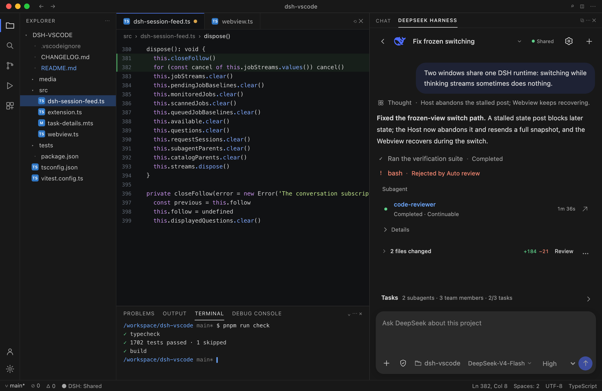

# DeepSeek Harness for VS Code 🐋

> [!NOTE]
> **本项目是 [Lixxx1/dsh-vscode](https://github.com/Lixxx1/dsh-vscode) 的个人 fork**（MIT 协议），独立维护，跟进比上游更新的 DSH 版本。
> 原始代码版权归 Lixxx1 所有。与 DeepSeek 及上游项目无隶属关系。
>
> Fork 仓库：https://github.com/fallleaves01/dsh-vscode

DSH Sidebar 将官方 DeepSeek Harness runtime 集成到 VS Code，提供项目会话、独立子代理详情、显式文件引用和原生差异审阅。

*本 fork 使用 DeepSeek Flash 作为编码代理进行维护。*

当前源码版本为 **0.2.2-alpha.2**。各版本变更见 [CHANGELOG.md](CHANGELOG.md)。原始扩展由 [Lixxx1](https://github.com/Lixxx1) 创建。

[English](README.md) | **简体中文**

[GitHub](https://github.com/fallleaves01/dsh-vscode)

[](https://github.com/fallleaves01/dsh-vscode/actions/workflows/ci.yml)
[](LICENSE)


<p align="center">
  
</p>

## ✨ 功能

- **会话与历史。** 通过官方 DSH runtime 接收流式回复、检查工具调用、处理审批与问题，并加载较早的消息。
- **失败回复恢复与重试。** 请求失败时保留已接收内容，在聊天页和子代理详情页显示错误码与可读原因；重新打开历史时恢复已保存的失败尝试。重试尝试折叠为一行（“Retrying model request (1/3) · 1s”“Retried model request”“Model request retry cancelled”），可展开查看重试延迟与失败原因；因输出 token 上限被截断的一轮会显示 DSH 的截断提示。重试分别保留；未能保存的输出明确标注仅在当前视图中可用。
- **完整会话目录。** 目录用于浏览和搜索最近或已归档会话，执行重命名、归档、撤销归档和恢复。点击新建会话进入完整对话页，可选择模型、推理强度、代理组合与权限。顶部列表用于切换主会话；子代理保留在所属会话的 Tasks 面板。
- **会话操作。** 可在会话菜单中置顶/取消置顶、重命名、分叉、归档/恢复和复制会话 ID。分叉已完成轮次时使用该轮自身的边界，后续停止或失败内容不会被复制。
- **独立子代理详情。** 点击工具调用卡片中的子代理名称进入子会话，或点击右侧箭头在主会话旁打开独立详情，查看实时状态、完整记录、工具输出、耗时和 token 用量。支持审批、回答问题和停止；父代理允许继续时可发送 Queue 或 Steer 消息，单次执行的子代理输入区为只读。外部执行按官方方式显示为信息行，没有本地会话记录。
- **后台任务与任务服务。** 查看有长度限制的进程输出、Goal 状态与轮次上限、Schedule 提醒与投递历史，以及 Workflow 阶段和任务日志。功能取决于 runtime 提供的服务；启用历史搜索后可搜索消息正文。
- **显式文件上下文。** 点击 `+` 搜索并添加文件或目录，用 `×` 逐项移除；也可输入 `@` 引用或执行 **Add Selection to Chat**。当前编辑文件和选区是可选建议。支持拖入资源和粘贴图片附件。
- **会话控制与队列。** 选择代理组合、Permission、Plan、模型和推理强度；排队发送后续消息，向运行中的任务发送 Steer，并检查或删除等待执行的斜杠命令。
- **紧凑的变更审阅。** 默认折叠显示文件数与增删行数；展开查看文件，或通过 Review 打开 VS Code Diff Editor。Keep/Revert 保留逐回合快照，并校验来源会话和项目；确认回退后再次检查目标。
- **DeepSeek 认证。** 配置 API key 或使用浏览器登录，查看账户状态与余额并退出。远程登录通过 VS Code 端口转发完成。
- **runtime 插件与配置。** 查找和管理 Tools、Skills、MCP、Memory 与 Agent Hooks。聊天工具栏齿轮打开对话内设置弹窗，包含模型提供商、Shell、Agent 循环、子代理、网页搜索和通用设置。支持模型目录编辑及只写凭据管理。
- **runtime 恢复。** 多个 VS Code 窗口复用受管 runtime，支持重连、会话占用诊断，以及停止已验证身份的遗留受管进程。已保存的外部 runtime 仅用于连接。
- **原生调试与键盘操作。** 可对 `.vscode/launch.json` 启用自主调试，管理断点、单步执行、调用栈和变量。`Cmd/Ctrl+Alt+D` 打开会话，`Cmd/Ctrl+Alt+E` 在编辑器标签页打开，`Cmd/Ctrl+Alt+L` 添加选区，`Cmd/Ctrl+Alt+F` 请求修复文件。会话与任务详情支持深色、浅色和高对比度主题。

## 🧭 可靠性与诊断

Runtime 到侧边栏的状态投递是有界的：同一时刻最多一个视图状态在途，较新的状态会合并为最新一个；2 秒内未完成投递则放弃，并由下一条 full snapshot 接替。若其后没有新状态，宿主机在 1.5 秒后补发一次 full snapshot，并限制为每 10 秒一次。Webview 在 live 阶段（打开、运行、停止中或已请求取消）连续 5 秒未收到状态时也会请求 resync；启动阶段另有 8 秒探测，覆盖“首个状态本身卡住”的情况。两条路径互为兜底，任意一侧通道卡住都能恢复视图。连续 3 次投递 stall 会提示 Reload Window，因为持续卡住的通道无法从视图内部恢复；若提示后仍然冻结，请运行 **Developer: Reload Window**。

选择会话后会立即显示 “Switching to …” 标题并在快照到达前保持 aria-busy；10 秒未完成会显示重试提示。渲染失败会上报到 Output 并触发 resync，而不是留下部分渲染的视图。

这些诊断写入本地 **DeepSeek Harness** Output 通道（**Show Output**）：每次会话选择一行，包含阶段与运行状态、打开/已打开耗时、慢投递、stall 与 resync 请求。内容包含会话标识、阶段与耗时；失败行还会包含 runtime 的错误文本。凭据由既有 DSH 错误包装脱敏，但分享前仍请检查该面板。扩展本身不包含遥测。参见[隐私与验证](#隐私与验证)。

启动与切换也是有界的：CLI 版本按可执行文件缓存，事件流基线与首次会话列表并行启动，重新解析视图或在编辑器打开时复用当前连接。切换时复用 runtime 级账户、翻译与 Schedule 事实以及按会话缓存的评分，而不是重新读取；隐藏的会话目录不渲染，无关的状态补丁不会重绘对话。

## 📦 安装

先安装官方 DeepSeek Harness CLI：

```sh
npm install -g @deepseek-ai/dsh
```

DSH 应安装在扩展实际运行的主机上；使用 Remote SSH 时，应安装在远程主机上。需要 DeepSeek Harness `0.1.2-rc.1` 或更新版本；历史搜索与 Schedule 需要 `0.2.0-rc.2` 或更新版本，实验性 bundle 已在 `0.2.2-alpha.2` 上验证，`0.2.1-rc.2` 与 `0.2.1-rc.3` 仍受支持。alpha CLI 本身要求 Node.js 24.9 或更新版本。

### 发布版

从 [GitHub Releases](https://github.com/fallleaves01/dsh-vscode/releases) 下载所需版本的 `.vsix` 附件，然后在 VS Code 命令面板运行 **Extensions: Install from VSIX...** 并选择该文件。本项目的扩展 ID 为 `fallleaves01.dsh-sidebar`。

发布附件可能晚于 `main`。如所需版本尚未提供附件，请按下方步骤构建源码。上游 Marketplace 扩展使用其自己的发布者和版本计划。

### 最新开发版

使用 `package.json` 指定的 pnpm 版本构建当前源码：

```sh
git clone https://github.com/fallleaves01/dsh-vscode.git
cd dsh-vscode
pnpm install --frozen-lockfile
pnpm run package
```

运行 **Extensions: Install from VSIX...** 并选择生成的 `dsh-vscode.vsix`。更新源码构建时，拉取最新代码并重新构建；已安装版本可在扩展视图中检查。

需要 VS Code 1.100 或更新版本，以及 Node.js `^22.19.0` 或 `>=24.0.0`。

安装社区 runtime 插件还需要确保 `pnpm` 已加入 PATH。

完整的本地检查使用 `pnpm run check`；`./build.sh` 会生成
`artifacts/dsh-sidebar-<version>.vsix`。其他设置包括
`reuseExistingRuntime`、`rememberExternalRuntime`、`executable`、`arguments`、
`startupTimeout` 与 `searchBaseUrl`。

### 升级到 0.2.2-alpha.2

0.2.2-alpha.2 跟随 DeepSeek Harness `0.2.2-alpha.2`，完成适配并降低启动与会话切换延迟。0.2.1 补齐 DSH 的会话操作并修复分叉边界；0.2.0 是面向 Stop 与会话切换的客户端可靠性版本。更新后重新加载 VS Code 窗口即可；共享的受管 runtime 不需要为此重启。它不要求升级 DSH：侧边栏在运行时探测能力，`0.2.1-rc.2`、`0.2.1-rc.3` 与 `0.2.2-alpha.2` 均可工作，实验性 bundle 仅在 runtime 提供对应契约时出现。

## 🚀 使用

1. 在 VS Code 中打开一个受信任的项目文件夹。
2. 在右侧选择 **DeepSeek**。如果没有显示，可以在 **其他视图** 中找到它。
3. 点击钥匙按钮配置 `DEEPSEEK_API_KEY`，或运行 **DeepSeek Harness: Sign In to DeepSeek Account** 登录。
4. 点击新建会话进入完整对话页，选择模型与推理强度，添加文件引用并发送。会话设置菜单控制权限与代理组合；使用 `/plan` 进入计划模式，输入 `/` 打开 DSH 官方命令。
5. 使用 Tasks 打开子代理详情，使用变更摘要检查改动；返回目录搜索、重命名、归档或恢复会话。
6. 点击聊天工具栏齿轮，或运行 **DeepSeek Harness: Open Settings** 调整 runtime 设置。插件管理器也提供该页面入口。

### 可选任务服务

运行 **DeepSeek Harness: Configure Task Services**，调整扩展的 `enableHistorySearch` 与 `enableSchedule` 设置。它们在标准受管 DSH Web runtime 中启用消息正文搜索与 Schedule；修改后需重启该 runtime。自定义或外部 runtime 需要在其自己的 profile 中提供相应服务。

### 多窗口共享运行时

启用 `reuseAcrossWindows` 后，同一主机、同一 OS 账号的窗口，在 `DSH_HOME` 和启动配置
一致时共用一个 DSH 进程，支持不同 VS Code 配置目录，并保留历史搜索和 Schedule。
首次启动窗口退出后，其他窗口可以继续使用；最后一个窗口正常退出时停止 DSH。
保留一个辅助进程负责读取 DSH 输出及异常清理，不修改 DSH 安装文件或用户配置，不写输出日志，也不自动重启 DSH。

顶部显示 **Shared** 表示本窗口已连接既有受管实例，悬停可查看 PID；**DSH** 表示由本窗口
启动，**External** 表示连接外部实例。点击该控件可重新连接当前窗口。尚未建立连接时，
**Connect** 或 **Retry Connection** 会先检查已有实例；没有可用实例时才按正常流程启动。
加载期间分别显示运行时连接、事件订阅和历史读取阶段，始终提供 **Show Output**；输出日志记录
各阶段累计耗时，不包含凭据。关闭 `autoStart` 时显示待连接状态，不再显示 Starting。

在 **Linux Remote–SSH** 下，每个窗口的使用记录和启动／停止操作均关联对应 VS Code Server 的
PID 与启动身份。Server 退出后，即使扩展主机残留，也不再视为有效使用者；其他 Server 下仍有
有效使用者时，实例继续运行。识别过程最多读取 `/proc` 中八级直接祖先进程，不扫描整个进程表或文件系统。

SSH 意外断线时，远程扩展主机在原生重连宽限期内继续执行。可在**本地用户 settings.json** 设置：

```json
{
  "remote.SSH.reconnectionGraceTime": 43200
}
```

单位为秒，上例为 12 小时。该 Remote–SSH 设置目前适用于 Linux 远程主机，修改后需重启
远程 VS Code Server 才生效；插件不会代为修改设置或重启 Server。正常关闭全部窗口可能立即
结束扩展主机，因此此设置不保证正常关闭后仍保留 12 小时。参见
[Remote–SSH 发布说明](https://github.com/microsoft/vscode-docs/blob/main/remote-release-notes/v1_107.md)。

所有有效使用者退出后，辅助进程每 5 秒检查一次，经过 30 秒宽限期开始清理。先发送 SIGTERM，
必要时在 4 秒后发送 SIGKILL，并限制等待后代进程持有输出管道的时间。POSIX 平台同时清理
DSH 专用进程组；主动脱离该进程组的工具不在此保证范围内。辅助进程被强制终止时，仍存活的
已连接窗口也能检测异常并清理身份已确认的 DSH。清理后可重新打开已保存历史，运行中的模型请求
和工具调用不能原地恢复；强制终止时尚未写入日志的事件也无法恢复。

这些时限依赖操作系统调度，不是实时保证。如果辅助进程和全部扩展主机同时被 SIGKILL，
就没有存活代码立即执行清理。下一次连接受管运行时，在打开会话之前先检查私有登记记录：
辅助进程仍正常运行且配置兼容时重连原实例；辅助进程已确认退出、没有其他有效使用窗口时，
核验残留 DSH 的 PID 与启动身份，先清理再启动替代实例。多个窗口同时恢复时串行处理，
共用一个替代实例。新辅助进程在连接地址发布前也记录 DSH 身份，因此启动中断可以按同样流程恢复。

SIGSTOP、内核 I/O 阻塞、信号被拒绝、身份或使用记录不可读，仍可能阻止清理。如果异常发生在
启动身份写入之前，也不能安全自动终止残留进程。无法确认时保留记录，不启动竞争实例；使用
**Restart Runtime** 或 **End a Leftover Runtime** 执行身份核验后的恢复。有其他有效使用窗口时，
需通过共享重启确认中断影响。外部、仅连接的运行时不进入自动停止路径。

两个窗口的启动配置需一致。连接失败或配置不兼容时，保留已有实例并显示错误。
单窗口连接恢复使用 **Reconnect**。**Restart Runtime** 可按当前窗口的配置替换已登记的
受管实例，包括因配置不兼容而启动失败的情况。若其他窗口仍在使用，将先确认重启会中断
该实例中的运行中对话、子代理和定时任务；取消则保留现有连接与工作。停止前再次核验
进程身份和受影响窗口，旧进程退出后才允许启动替代实例。其他窗口需使用一致配置并重新加载，以连接新实例。
外部 runtime 仍仅用于连接。
原生自主调试桥接绑定单个 VS Code 窗口，共享模式需关闭 `autonomousDebugging`。

从早于 0.1.15 的版本升级时，先完成运行中任务，在所有使用窗口更新插件，再执行 **Restart Runtime**
替换旧辅助进程。0.1.14 更新了托管协议，0.1.15 增加启动身份记录；仅重新连接旧实例不能补充这些保护。
0.1.16 的连接界面更新可在重新加载窗口后复用配置兼容的 0.1.15 辅助进程，无需为此重启 DSH。
私有登记目录为 `~/.dsh-vscode/runtimes/`，按主机与 DSH home 分区；已知旧登记目录在迁移时
继续保存原有连接记录，避免遗漏旧窗口的使用者记录。

### DSH 设置页

点击聊天工具栏齿轮可在对话内打开设置弹窗，使用官方图标、左侧导航和卡片尺寸；窄侧栏
切换为图标导航。命令 **DeepSeek Harness: Open Settings** 可在编辑器标签页中打开相同页面。页面按官方
DSH 设置卡片组织：账户状态与会话日志上传、提供商端点与模型目录、Shell 超时和
输出上限、并行工具调用数、子代理限制与可选模型，以及网页搜索。外观和快捷键使用
VS Code 原生设置入口。搜索页可选择 Messages API 或 Search / Fetch API，分别保留端点、
限制参数和只写密钥草稿。自定义 Pi 提供商的模型可按 runtime schema 编辑推理等级与 API 参数值。

提供商修改在点击保存后提交；模型查询只返回候选列表，选择后仍需保存。逐项重置恢复
继承值；冲突时保留草稿，切换 runtime 时清空旧草稿。外部 attach-only runtime 可查看设置。

在设置页录入的提供商密钥通过 DSH 凭据服务保存，默认本地文件为
`$DSH_HOME/.credentials.yaml`，POSIX 权限仅允许所有者访问。该存储独立于提供商
profile，也不同于原有的 VS Code SecretStorage 密钥。它不是加密保管库，不能隔离同一
OS 用户运行的工具。页面不会读回已存密钥；本仓库及其 VSIX 打包规则排除该凭据文件及备份。

### DSH 0.2.2-alpha.2 实验性功能

本扩展已针对官方 DeepSeek Harness `0.2.2-alpha.2` 运行时完成验证；`0.2.1-rc.2` 与 `0.2.1-rc.3` 仍受支持。实验性 bundle 仍需在运行时 profile 中按需启用；插件不会自动代为启用（runtime 允许写入时，插件页可显式切换），只在运行时暴露相应契约时显示对应界面。运行时缺少该能力时，界面保持原有行为。alpha 版本新增以 Web 端为先的可选 bundle（Live Share、Forge、Computer Use 与个性化推荐）；它们会出现在插件清单中并显示平台/安装状态，但本侧边栏未实现其 Web 面板。

以下 alpha.2 能力属于 Web 端，本侧边栏未实现：Live Share、Forge、Computer
Use 与个性化推荐面板；Statistics 标签页；creation、文件拖拽与插件推荐卡片。
其工具使用通用工具卡；action card 提议（`propose_action`）同样以通用工具卡
显示，不提供卡片按钮。插件详情文档、版本列表、bundle 升级
（`pluginManager/readBundleDetail`、`listVersions`、`updateBundle`）与市场条目
详情（`pluginMarket/readEntryDetail`）未实现，请使用 DSH Web 插件页。未安装的
on-demand bundle 不在此页列出，请先从 DSH 插件管理器安装。引用消息按 Markdown blockquote 显示；Web 的
选中文本引用控件不在侧边栏输入区提供。Auto review 审批原因跟随编辑器语言；
Auto review 的失败（`AUTO_REVIEW_FAILED`）按普通工具失败呈现。Web 外观设置
（`ui-theme`、`ui-settings`、`ui-conversation`、`ui-chat`（含 `foldedReplies`）与
`locale`）以及 Web 的默认模型/默认权限设置不适用于 VS Code；模型 badge 不显示；
缺少 `bytes` 的旧 PNG/JPEG 引用在 alpha.2 无法读取。Computer Use 还需要 macOS
与 runtime 自带的 CUA native 二进制；缺失时 bundle 开关会报告平台/操作失败，
而不是显示为已启用。

- **Auto review 权限预设。** 权限选择器读取 `permissionPresets/catalog`；auto-review 集成挂载后，选择器出现实验性 `auto` 预设并标注 `EXP`。无论从菜单选择还是键入 `/permission auto`，切换前都要求显式确认：该预设不使用沙箱，由同一模型逐次复审每个工具调用，可能误放行或误拒绝操作，并额外消耗 token。运行时不提供该目录时，继续使用内置三档预设。
被 Auto review 拒绝的工具调用在折叠行显示 “Rejected by Auto review”，展开后显示 “Tool was not executed. Reason: …”；缺少原因时回退为 “Auto review did not authorize this action”。
- **Agent Teams。** 存在 `agentTeam` Session 投影时，Tasks 面板显示持久团队名册（生命周期阶段、Lead/Teammate 角色）与共享任务板（状态、就绪、blocked-by、owner、write scopes）。成员行可打开对应会话；Team 工具卡在成员名与投影匹配后链接到该成员。任务板为只读：任务状态由运行时持有，通过 Team 工具写入。
成员行显示生命周期阶段，并根据会话列表显示 Running、Inactive、Failed 或 Provisioning；投影中的 `phase` 本身只记录成员记录存在。
- **会话标题实时刷新。** 随对话更新标题的提供者沿用既有 `title` 投影与 `session/title` 事件；侧边栏本就从该投影刷新标题栏与会话列表，因此标题无需重新加载列表即可更新。
- **实验性设置与 bundle 管理。** 设置页在 Plugins → Experimental bundles 下列出运行时的可选 bundle（启用状态、版本、描述）；当运行时由本扩展管理时，可通过 `pluginManager/setBundleEnabled` 启停。运行中的任务不会阻止修改：该决定由运行时作出，它返回 `applied` 或 `restart-required`，页面如实呈现而不是假装已经生效。切换在以下情况会被拒绝：附加到外部运行时，或 runtime 不允许写入设置；页面会在变更前要求确认。运行时提供相应设置 namespace 时，同一页面还呈现 Reasoning translation（`cot-translation`：提供方、目标语言）、Voice input（`speech-to-text`：提供方、语言）与 Plugin market（`plugin-market`：索引 URL 列表）；未挂载的 bundle 会隐藏对应卡片。挂载翻译 bundle 后，展开的思考内容会经 `cotTranslation/limits` 与 `cotTranslation/translate` 就地翻译，默认显示译文，可切换到原文；所选服务不可用时显示 Retry。展开的思考内容会发送给该翻译服务，可能包含私有代码或对话细节。

其余实验性 bundle 的现状（完整矩阵与证据见 [alpha.2 适配记录](docs/DSH-0.2.2-ALPHA2-ADAPTATION.md)；此前的 [rc.3 记录](docs/DSH-0.2.1-RC3-ADAPTATION.md) 保留作对照）：

- **会话搜索**新增 `session_search` 等模型工具，使用通用工具卡；侧栏正文搜索仍使用标准 `session/search` RPC。不要同时启用该 bundle 与 `enableHistorySearch` 任务服务而不核对 profile：部署中可能出现两个 `session-query-sqlite` 实例。
- **插件市场与语音输入** 已提供上述配置卡片，但功能界面尚未实现：无市场发现/搜索/安装（`pluginMarket/*`），无语音采集与转写（`speech/*` 的流式方法需要复用现有流通道）。思考翻译已在上一节说明且已实现，不再属于未实现项。这些 bundle 保持按需启用且以 Web 端为先；已安装但停用时不改变侧边栏行为。
- **持久终端、Ralph 循环与徽章技能**无需侧边栏专属实现：其工具与技能由通用工具卡或既有 `skills/list` 视图呈现。侧边栏不提供持久终端面板。PTC 嵌套的 `tool/ptc-dispatch` 明细不单独渲染；父工具卡显示结果。
- **Git 工作树：** `create_worktree` 以通用工具卡运行，但生效的 `workingDirectory` Session 投影尚未被消费。文件路径解析与变更审阅仍以项目根为基准，因此侧边栏不会跟随切换了工作目录的会话。
- **Agent Team profile 与 Inspector profile** 是纯 profile bundle。Agent Teams 由上述投影与工具支持；Inspector profile 是仅 Web 的 DevTools 界面，不提供 Gateway RPC，VS Code 侧未实现。

### 自主调试

在 VS Code 设置中启用 **DeepSeek Harness: Autonomous Debugging**，并在 `.vscode/launch.json` 中添加调试配置。

之后，DeepSeek 就能直接从侧边栏启动调试器、设置断点、单步执行、检查运行时变量、修复代码并验证结果。

核心会话与设置接口已通过 DeepSeek Harness `0.2.1-rc.2` 的隔离检查；此前已验证 `0.2.0-rc.2`、`0.1.7-rc.1` 与 `0.1.7-rc.2`。实验性 bundle 行为随后在隔离的 `0.2.1-rc.3` 与 `0.2.2-alpha.2` 运行时上完成验证，详见 [alpha.2 适配记录](docs/DSH-0.2.2-ALPHA2-ADAPTATION.md)。近期版本已补齐外部任务、Search / Fetch 设置、自定义推理映射与用户消息脱敏，详见[适配记录](docs/GAP-ANALYSIS.md)。工作目录及 Worktree 集成仍需专项验证。可选服务取决于实际安装的 runtime 版本和 profile。

## 隐私与验证

已发送用户消息按官方 DSH 规则隐藏可识别的凭据，支持逐项显示或隐藏。这只控制界面显示；
不会改写模型请求、存储的历史、助手或工具输出，以及显式复制消息的内容。未被规则识别的
敏感信息仍可能显示。

上文所述的可靠性诊断只写入本地 Output 通道，扩展不会上传它们。DSH 设置页另有自己的 **Upload session logs with official model API requests** 选项；这是独立的 DSH 隐私控制，本扩展从不主动启用。请把 Output 面板视为诊断数据：失败行可能包含 runtime 的错误文本（例如绝对路径），在将其放入 issue、截图或共享日志前请先审阅。

本扩展不收集遥测。凭据脱敏覆盖官方 DSH 规则识别的形式（API key、bearer token、URL userinfo 或查询参数中的 secret、cookie 与 authorization 字段）；它不保证任意内容都不会出现在 runtime 错误文本中。

通过钥匙按钮配置的 API key 使用 VS Code SecretStorage 保存。已记住的 runtime 启动 URL 保存在仅所有者可访问的本地文件中，不参与同步。文件引用由用户显式添加；添加文件会让 DSH 获得相应上下文，提示词与所选上下文可能发送到配置的模型服务。

[alpha.2 适配记录](docs/DSH-0.2.2-ALPHA2-ADAPTATION.md)、较早的 [rc.3 记录](docs/DSH-0.2.1-RC3-ADAPTATION.md) 与[复核记录](docs/RELEASE-REVIEW-2026-10-15.md) 列出实现证据、隐私检查、测试覆盖与验证限制。开发阶段使用的 `braces` 依赖仍有基于版本的安全告警；本地深度限制补丁覆盖已报告的递归失败，该依赖不进入 VSIX。

缺陷报告与功能建议请提交至 [GitHub Issues](https://github.com/fallleaves01/dsh-vscode/issues)。

## License

[MIT](LICENSE)

DeepSeek 标识（`media/deepseek.svg`）与动态尾迹（`media/deepseek-tail.png`）来自
[deepseek-ai/deepseek-harness](https://github.com/deepseek-ai/deepseek-harness)
（MIT），已适配 VS Code 主题色。
